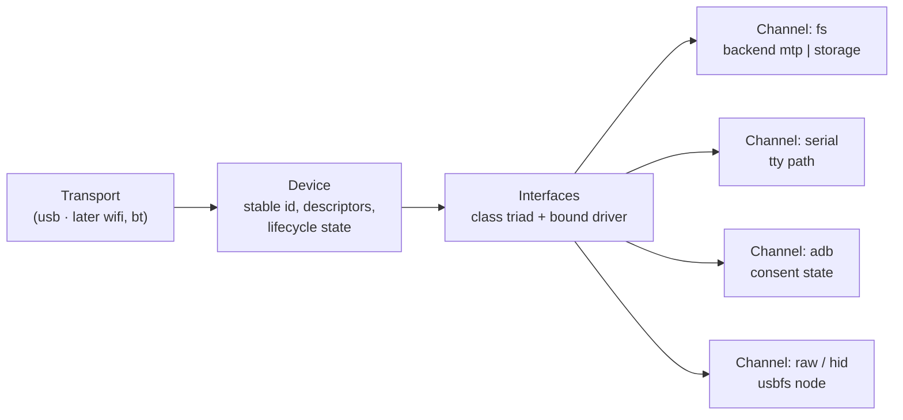

# Plan: from `garmin-connector` to a generic device connector

Status: **proposal, 2026-11-08** — nothing in `specs/` has changed yet. Per
[specs/README.md](specs/README.md) rule 4 the constitution only changes after
approval; Phase 1 below is that change.

Companion document: [docs/ecosystem-architecture.md](docs/ecosystem-architecture.md)
(how the probe and the applications are built on top of this repo).

## 1. Why

Today every device project carries its own transport code:

| Repo | Device | Own transport code today |
|---|---|---|
| `garmin-connector` (this) | Garmin Venu X1 | GVFS/MTP discovery, stale-mount remount, `gio` fallbacks, USB-presence hint |
| `pocketbook_lux_5` (pbtk) | PocketBook Touch Lux 5 | `host/pbtk/usb.py`: mass-storage mount search, `udisksctl` eject; Wi-Fi agent (T1) |
| `probe` | anything on USB | sysfs descriptor snapshot, hotplug watch, USB-C role check (shell) |
| `wayforge` | (Garmin, indirectly) | none — "file transfer to a watch is external" |
| `mmIV`, `inkquest` | PocketBook | go through pbtk |

The same problems get solved several times over: finding the device, telling
it apart from other devices, finding where it's mounted, handling "plugged in
but not ready yet", writing despite MTP's limits, ejecting safely. This repo
already has the most hardened version of that code (FCT-4, 7, 9, 13, 15,
18–23, 27, 28). The plan is to keep that code, generalise it, and move the
Garmin-specific parts out.

## 2. What the connector is — and is not

**Rule of thumb:** the connector knows transports, USB, filesystems and byte
streams. It never knows what a `GARMIN` folder or a `.fit` file means.

| The connector owns | The connector does NOT own |
|---|---|
| Listing and watching attached devices (USB first; Wi-Fi/Bluetooth later) | Reading what the device *is* beyond its descriptors (`GarminDevice.xml`, PocketBook firmware facts) → **probe** |
| A stable identity for each physical device, also across mode switches | Folder meanings, file summaries, catalogs (FR-13 catalog) → **probe profiles** |
| Working out the *channels* a device offers (filesystem, serial, ADB, raw) and their state | Course upload into `NewFiles/`, course preview, GPX/FIT parsing → **Garmin kit / wayforge** |
| Opening those channels: mount, unmount, eject, stale-mount recovery | Deploying apps, screenshots, taps → **pbtk** |
| Generic filesystem operations that work the same on MTP and mass storage | Any purpose-specific UI |
| One versioned, machine-readable contract (CLI + optional local API) | |
| Transport *quirks* as data (e.g. "091e:0003 is a start-up mode, wait") | |
| A generic device explorer GUI (today's file browser, minus the Garmin parts) | |

## 3. Model



- **Device** — one physical unit. Id = `usb:<serial>` when a serial string
  exists, otherwise `usb:<vid>:<pid>@<bus-port-path>`. A *lineage* rule links
  records that are one physical device in different modes: same bus-port path,
  same vendor, re-enumerated within a short window (the Venu X1 goes
  `091e:0003` with no serial → `091e:51fb` MTP after ~35–50 s, FCT-28).
- **Interface** — straight from sysfs: class/subclass/protocol, endpoints,
  bound kernel driver (readable without root; see `probe/docs/findings.md`).
- **Channel** — something a consumer can actually use, resolved from the
  interfaces plus the OS state:

| Channel | Comes from | Resolved to | Possible states |
|---|---|---|---|
| `fs` / `storage` | interface class 08 (`usb-storage`/`uas`) | block device → mount point (udisks or manual) | `ready`, `needs-mount`, `read-only`, `busy` |
| `fs` / `mtp` | class 06/01/01 or vendor MTP interface | GVFS mount path (FCT-4, 18), `gio` fallbacks (FCT-13, 15, 19–21) | `ready`, `needs-mount`, `stale` (FCT-27) |
| `serial` | `cdc_acm` / USB-serial drivers | `/dev/ttyACM*` / `/dev/ttyUSB*` | `ready`, `no-permission` |
| `adb` | interface ff/42/01 | adb serial | `unauthorized`, `ready` (consent is on the device) |
| `raw` / `hid` / `dfu` | everything else | usbfs / hidraw node | `ready`, `no-permission`, `claimed-by-kernel` |

- **Lifecycle states** for a device: `enumerating` → `transitional` (a
  quirk says "this mode is temporary") → `ready` | `degraded` (a channel is
  stale or needs permission) → `gone`.

## 4. Contract (v1 sketch)

Consumers are written in Go, Python (pbtk) and browser TypeScript (wayforge),
so the contract is a **process boundary**, not a library: a CLI with JSON
output and an optional local server speaking the same JSON. Every document
carries `"schema": "connector/v1"`.

```
connector list [--json]                       # every attached device + channels
connector watch [--json]                      # NDJSON events: attached / changed / detached
connector show <device>                       # one device: descriptors, interfaces, channels
connector mount|unmount|eject <device>
connector fs <device> ls|tree|stat|df <path>
connector fs <device> get|put|mkdir|rm|touch <path> ...
connector serve [--socket PATH] [--port N]    # same operations over HTTP/Unix socket + SSE events
connector explore                             # generic web device explorer (today's GUI file browser)
```

`<device>` accepts the full id, a unique prefix, or a filter such as
`vid=091e`. With exactly one device attached it can be left out, which keeps
today's single-watch behaviour (ASM-3) as a convenience instead of a limit.

Example `connector show --json` output:

```json
{
  "schema": "connector/v1",
  "id": "usb:0000d7975783",
  "transport": "usb",
  "state": "ready",
  "lineage": ["usb:091e:0003@1-4"],
  "usb": { "vid": "091e", "pid": "51fb", "bcdDevice": "0100", "speed_mbps": 480,
           "manufacturer": "Garmin", "product": "Venu X1", "serial": "0000d7975783",
           "port_path": "1-4" },
  "interfaces": [ { "number": 0, "class": "06/01/01", "driver": null } ],
  "channels": [
    { "kind": "fs", "backend": "mtp", "state": "ready",
      "roots": ["/run/user/1000/gvfs/mtp:host=091e_51fb_0000d7975783/Internal Storage"] }
  ],
  "quirks": []
}
```

Machine-checkable: a JSON Schema for v1 is part of the specs, and `--fixture
DIR` replays a recorded device so the probe and the apps can test without
hardware, the way `pbtk sim` does today.

## 5. What carries over, what moves out

| Today | Fate |
|---|---|
| FR-1 discovery (GVFS MTP scan, stale remount, USB hint) | **Kept, generalised** to all USB devices and both fs backends |
| FR-3 `status` | **Replaced** by `list` / `show` |
| FR-4 `ls`/`tree`, FR-11 `mkdir`/`rm`/`touch`/`put` | **Kept** as `connector fs …`, backend-neutral |
| FR-7/8/12 dashboard, file browser, fs manipulation; NFR-4 origin gate | **Kept** as `connector explore`, with no Garmin wording |
| FR-2 `GarminDevice.xml`, FR-5 `info` (Connect IQ, firmware) | **Moves** → Garmin probe profile |
| FR-13 folder catalog & file summaries | **Splits**: the generic mechanism (basis = documented/observed/inferred) → probe; the Garmin catalog → Garmin profile |
| FR-6/9 course upload, FR-10 course preview | **Move** → Garmin kit, used by wayforge |
| FCT-4, 7, 9, 10, 11, 13, 15, 16, 18–23, 27 | **Stay** (transport/OS facts) |
| FCT-1, 28 | **Generalised** ("a device may expose only MTP" / "a device may enumerate in a temporary mode first"); the Venu X1 specifics become quirk data plus evidence |
| FCT-2, 3, 5, 6, 8, 12, 14, 17, 24, 25, 26; ASM-7, 9, 10 | **Move** to the Garmin profile/kit corpus |

Nothing is thrown away: the moved specs go into `specs/_handoff/garmin/`
until the probe repo and the Garmin kit take them over.

## 6. Phases

Each phase follows the repo's own workflow: **a spec PR first, then a
single-shot regeneration PR** that has to pass the gate (`go test ./...`,
`go vet`, `gofmt`), and then a check on real hardware.

### Phase 0 — Decisions (this PR)
Settle the open decisions in §8. Exit: the decisions are recorded in the PR.

### Phase 1 — Re-found the spec corpus
- Rewrite `constitution.md` §1 Purpose, §4 Architecture and §5 Out of Scope
  around "generic device connector" (still tech-agnostic, per the standing rule).
- Re-sort facts and requirements as in §5; move the Garmin specs to `specs/_handoff/garmin/`.
- New facts to add as **assumptions until verified**: sysfs descriptors and
  bound drivers can be read without root; mass-storage mounts land under
  udisks paths (`/run/media/$USER`, `/media/$USER`) that differ per distro;
  ADB access needs consent on the device; serial nodes need group permission.
- New namespaces: `core/enumeration`, `core/identity`, `core/channels`,
  `core/fs`, `core/contract`, `cli/`, `gui/explorer`.
- ADR-0004 "process-boundary JSON contract" and ADR-0005 "sysfs + udev
  netlink for enumeration and hotplug". The rename goes in the same PR if approved.

Exit: a clean agent could regenerate from the specs alone (rebuild test).

### Phase 2 — Enumerate, identify, watch (USB)
- Read every USB device from sysfs: descriptors, strings, interfaces, drivers, speed, power.
- Build the stable id and the lineage rule; load quirk data (`091e:0003` → transitional).
- `connector list` / `show` / `watch`, with hotplug through netlink plus a polling fallback.

Exit: plug and unplug the Venu X1, the PocketBook, a phone and a USB stick;
`watch` reports each one correctly, including the X1's transitional phase as
**one** device.

### Phase 3 — Channel resolution
- Map interfaces to channels (table in §3) and their states.
- `fs/mtp`: today's GVFS code, not limited to `GARMIN` any more.
- `fs/storage`: block device → mount point (udisks), with `needs-mount` when not mounted.
- `serial`, `adb`, `raw`: detection and state only, no I/O yet.

Exit: every device in the test matrix (§7) shows the expected channels and states.

### Phase 4 — Channel operations
- `mount` / `unmount` / `eject` for both fs backends (udisks; GVFS mount/unmount;
  the FCT-27 remount generalised).
- `connector fs …` with one behaviour on top of both backends: `gio`
  fallbacks only where MTP needs them, bottom-up delete (FCT-21), depth limits
  (ASM-6), the root-delete guard generalised to "never delete a storage root".
- Safety: mutations need an explicit device (no implicit "first device"
  when two or more are attached).

Exit: `put`/`get`/`rm` round-trip on the Venu X1 (MTP) and the PocketBook (mass storage).

### Phase 5 — Contract v1 and surfaces
- JSON Schema `connector/v1`, `--fixture` replay mode, recorded fixtures for the X1 and the PocketBook.
- `connector serve` (Unix socket + loopback HTTP, NFR-4 gate, SSE events) and `connector explore`.

Exit: the probe (next document) can be built against fixtures alone.

### Phase 6 — Garmin hand-off
- Move `specs/_handoff/garmin/` into the Garmin profile (probe repo) and the
  Garmin kit; wayforge gets "send to watch" through the kit.
- Remove the handoff folder from this repo.

Exit: wayforge puts a course on the X1 with nothing Garmin-specific left in the connector.

## 7. Device test matrix

| Device | Expected channels | Exercises |
|---|---|---|
| Garmin Venu X1 | `fs/mtp` | transitional mode, lineage, stale mount, `gio` fallbacks |
| PocketBook Touch Lux 5 | `fs/storage` (FAT) | udisks mount/eject, replaces pbtk `usb.py` |
| Pixel 7 (from the `probe` findings) | `adb` and/or `fs/mtp`, depending on USB mode | consent state, multiple interfaces, mode switch |
| Any USB stick | `fs/storage` | baseline |
| Microcontroller / calculator, if one is at hand | `serial` or `raw`/`dfu` | channels without a filesystem |

## 8. Open decisions (recommendations first)

1. **Name.** Rename the repo to `connector` (GitHub redirects the old URL),
   binary `connector`. Alternatives: `devlink`, `usb-connector` (too narrow once Wi-Fi arrives).
2. **Language.** Stay on Go (ADR-0001): one static binary, no runtime on the
   host (NFR-2), and the hard-won MTP code is already Go. Consumers stay in
   their own languages because the contract is a process boundary.
3. **Daemon or not.** CLI-first and on-demand (keeps ASM-1); `serve` is
   optional and used by the GUI and long-lived apps. No system service.
4. **Where quirks live.** In the connector, as data, only for transport
   behaviour (modes, timing). Anything about *content* belongs to probe profiles.
5. **Browser consumers (wayforge).** NFR-4 only lets the connector's own page
   act. Recommendation: an explicit origin allow-list plus a per-app token in
   `serve`, opt-in per origin. The alternative (a bridge in each app) duplicates work.
6. **Old `probe` repo scripts.** Fold `usb-snapshot`/`usb-watch` into the
   connector (Phase 2) and keep the repo's research docs; see the ecosystem
   document for what that repo becomes.
