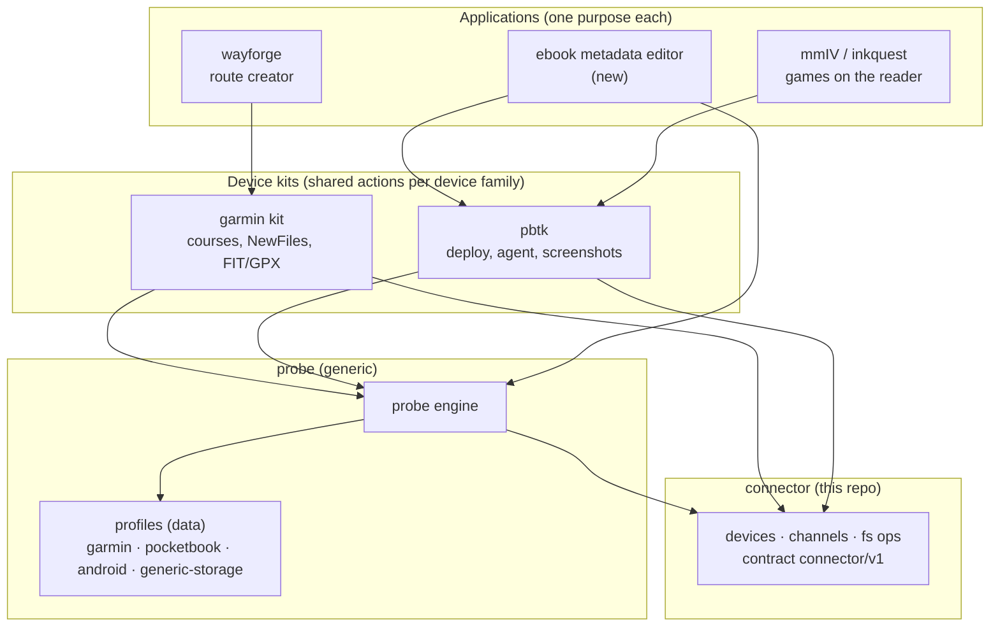
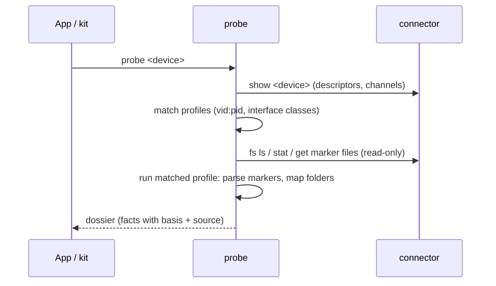
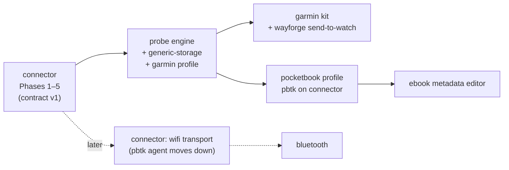

# Ecosystem architecture: connector → probe → applications

Status: **proposal, 2026-11-08**. Companion to [PLAN.md](../PLAN.md), which
covers the connector itself. This document is about everything built on top
of it, to be picked up once the connector reaches contract v1 (PLAN Phase 5).

## 1. Layers



You described three layers: connector, probe, application. This adds one thin
layer, **device kits**, because two applications for the same device would
otherwise both write things like "put a course in `NewFiles/`". pbtk already
is such a kit for the PocketBook. A kit is optional: an application with
nothing to share can talk to the probe and the connector directly.

| Layer | Answers | Knows about | Never does |
|---|---|---|---|
| **connector** | *Is something there and how do I reach it?* | transports, USB descriptors, mounts, MTP, byte streams | interpret content |
| **probe** | *What is on the other end?* | profiles: how to recognise a device family and describe it | change the device (except opt-in active probes, see §2.4) |
| **kit** | *How do I do X on this device family?* | device semantics: course import, app deploy, library DB | UI choices |
| **application** | *What does the user want to do?* | one purpose | transport or discovery code |

**Dependencies only point downwards.** The connector depends on nothing of
ours. The probe depends on the connector contract. Kits depend on both.
Applications depend on kits (or on the probe/connector directly).

## 2. The probe

### 2.1 Job

Given a device from the connector, collect as much as can be known about the
other end and return it as one document, the **dossier**. The probe is the
"discovers the environment" layer: the same engine for every device, with
device knowledge kept in profiles.



### 2.2 Stages

1. **Passive.** Descriptors, interfaces and channels from the connector.
   Zero bytes sent to the device beyond what the OS already did.
2. **Channel read.** Read-only use of the open channels: storage capacity, a
   depth-limited tree, marker files (`GARMIN/GarminDevice.xml`, PocketBook
   `system/` files, `adb shell getprop` once ADB is authorised).
3. **Profile interpretation.** The matched profile turns raw findings into
   meaning: model, firmware, installed apps, what each folder is for, file
   summaries (today's FR-13 mechanism, generalised).
4. **Active (opt-in only).** Anything that leaves something behind or needs
   the owner on the device: pbtk's `probe install`/`collect` app, a serial
   handshake. Off by default and marked as active in the dossier.

### 2.3 Dossier

```json
{
  "schema": "probe/v1",
  "device": "usb:0000d7975783",
  "probed_at": "2026-11-08T14:02:11Z",
  "profiles": ["garmin"],
  "facts": [
    { "key": "model", "value": "Venu X1", "basis": "documented",
      "source": "fs:GARMIN/GarminDevice.xml#Model/Description" },
    { "key": "firmware", "value": "19.15", "basis": "documented", "source": "..." },
    { "key": "folder:GARMIN/NewFiles", "value": "incoming files, imported on disconnect",
      "basis": "observed", "source": "profile:garmin" }
  ],
  "stages_run": ["passive", "channel-read", "profile"]
}
```

- Every fact has a **basis** (`documented` / `observed` / `inferred`, the same
  idea as FR-13 today) and a **source**, so an application can decide how
  much to trust it.
- Dossiers are cached per device id and **diffable**, so "the firmware
  changed since last time" comes for free.
- This ties into the spec workflow you already use: an `observed` dossier
  fact is a ready-made candidate `FCT-x` for the repo that depends on it.

### 2.4 Profiles

A profile is mostly **data** (match rules, marker files, folder catalog) plus
small parsers where data isn't enough. First four:

| Profile | Matches | Comes from |
|---|---|---|
| `garmin` | vid `091e` | this repo's FR-2, FR-5, FR-13 catalog, FCT-2/3/5/6/8/17/25/26 |
| `pocketbook` | PocketBook vid / FAT volume with `system/` | pbtk `probe.py` and `docs/FACTS.md` |
| `android` | ADB / MTP interface on phone vids | `probe/docs/manipulation-surface.md` |
| `generic-storage` | any `fs` channel | fallback: capacity, tree, file types |

### 2.5 Which repo

Use the existing **`probe`** repo for the generic probe; the name fits and its
research docs (`findings.md`, `manipulation-surface.md`) are the start of its
fact base. Its shell scripts for enumeration move into the connector (PLAN
Phase 2). **`usb-active-probe`** is empty: drop it, or keep it only if you
want active probes in a separate repo (not recommended; the active stage is
just an opt-in stage of the same engine).

## 3. Device kits

| Kit | Repo | Uses | Provides to apps |
|---|---|---|---|
| **pbtk** | `pocketbook_lux_5` (exists) | replaces `host/pbtk/usb.py` with the connector, `probe.py` with the `pocketbook` profile | deploy, logs, agent (T1 Wi-Fi), screenshots, MCP, books on the device |
| **garmin kit** | new, e.g. `garmin-kit`, or a package in wayforge if wayforge stays its only user | connector `fs`, `garmin` profile | `send course` (GPX/FIT → `NewFiles/`, FCT-12/17/24 name rules), course list, course preview (FR-10) |

pbtk's Wi-Fi agent is a second transport. When the connector gets a `wifi`
transport, the agent's discovery (UDP beacon) and token handshake can move
down into it, and pbtk keeps only the PocketBook-specific commands.

## 4. Applications

| App | Repo | Path through the stack |
|---|---|---|
| Route creator | `wayforge` | browser → garmin kit (via `connector serve` with an allow-listed origin and a token, PLAN §8.5) → watch |
| Ebook metadata editor | new | probe (`pocketbook` profile: where the books and the library DB are) → pbtk/connector `fs` → edit → write back |
| mmIV, inkquest | existing | pbtk only, unchanged for them |

## 5. Rules for every repo

1. **Contracts are JSON across processes**, versioned (`connector/v1`,
   `probe/v1`). No repo imports another repo's code, so Go, Python and
   TypeScript can stay mixed.
2. **Fixtures go with the contract.** The connector ships recorded devices
   (`--fixture`), the probe ships recorded dossiers. Every layer is tested
   without hardware; real-device checks are a separate, explicit step.
3. **Knowledge sits as low as it can.** A truth about USB/OS goes in the
   connector's facts, a truth about a device family goes in its probe profile,
   a truth about a workflow goes in the kit or app.
4. **Same spec workflow everywhere.** Each repo keeps its own `specs/` with a
   tech-agnostic constitution; cross-repo dependencies are recorded as
   facts/assumptions about the contract version they rely on.
5. **Mutations are explicit.** Only kits and apps change devices, always
   with a named device id; the probe is read-only unless an active stage is
   asked for.

## 6. Order of work



1. Connector to contract v1 (PLAN.md).
2. Probe engine with `generic-storage`, then `garmin` (its specs are already
   waiting in this repo's handoff folder).
3. Garmin kit + wayforge "send to watch". This proves the full stack end to end.
4. `pocketbook` profile; pbtk switches to the connector and the probe.
5. Ebook metadata editor, the first app built on the stack from scratch.
6. Wi-Fi transport, then Bluetooth.
